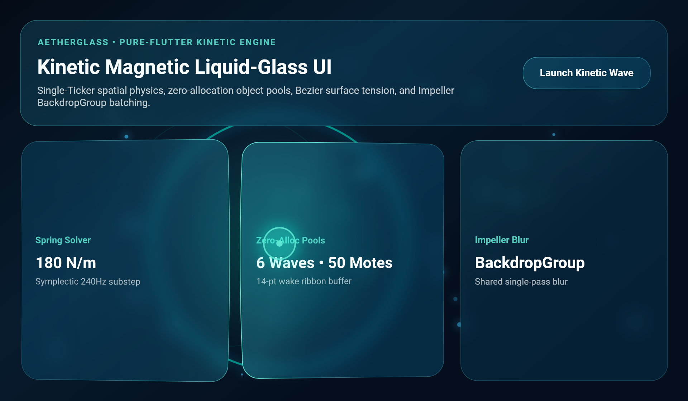
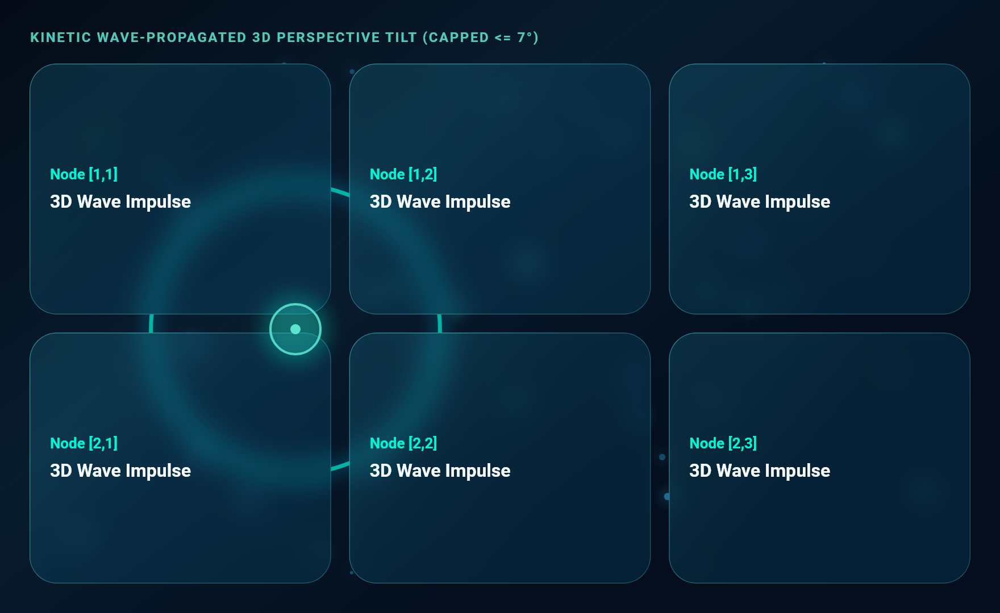
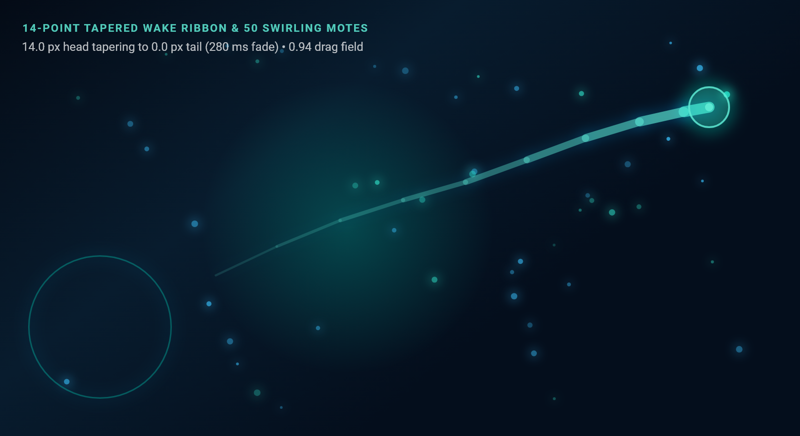
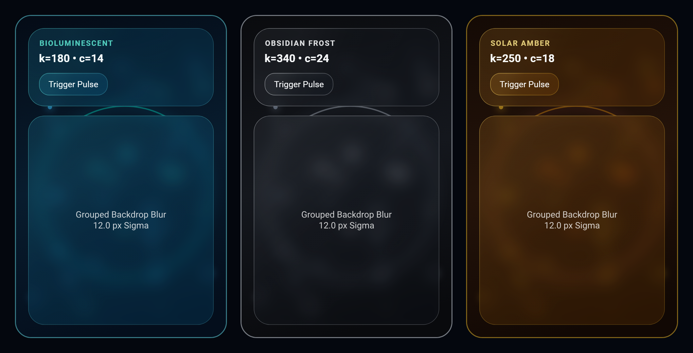
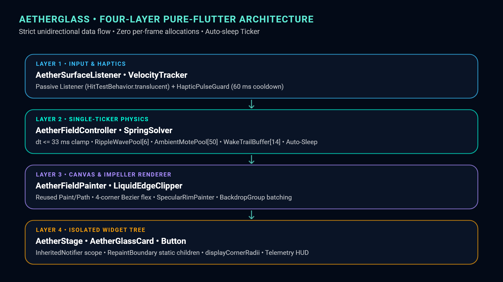
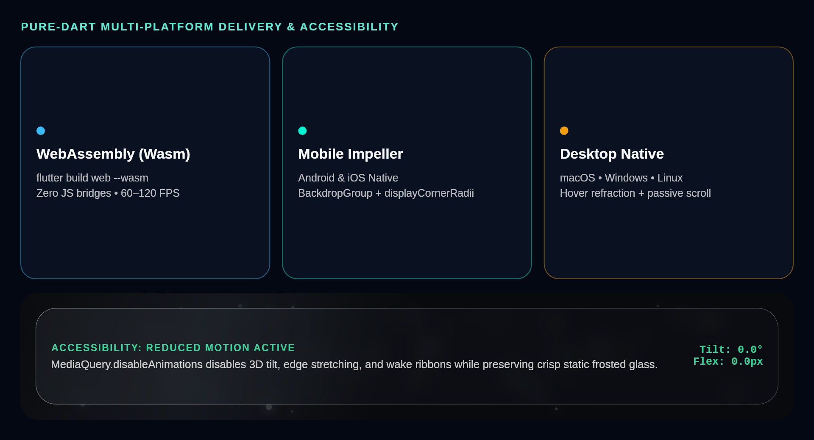

<div align="center">

# AetherGlass

**A zero-dependency, 100% pure-Flutter kinetic liquid-glass rendering & spatial physics engine engineered for 60–120Hz mobile, desktop, and WebAssembly (Wasm) hardware.**

[](https://flutter.dev)
[](pubspec.yaml)
[](docs/ARCHITECTURE.md)
[](example/web/index.html)
[](.github/workflows/ci.yml)
[](LICENSE)

[**Hero Showcase**](#hero-showcase) • [**The Engineering Problem**](#executive-overview--the-engineering-problem) • [**Capabilities & Physics**](#core-visual--physics-capabilities) • [**Theme Presets**](#physics--visual-theme-presets) • [**Architecture**](#system-architecture--zero-allocation-memory-model) • [**Impeller & Benchmarks**](#impeller-gpu-compositing--benchmark-methodology) • [**Quick Start**](#installation--quick-start) • [**API Reference**](#public-api-reference)

</div>

---

## Table of Contents

1. [Hero Showcase](#hero-showcase)
2. [Executive Overview & The Engineering Problem](#executive-overview--the-engineering-problem)
3. [Core Visual & Physics Capabilities](#core-visual--physics-capabilities)
4. [Physics & Visual Theme Presets](#physics--visual-theme-presets)
5. [System Architecture & Zero-Allocation Memory Model](#system-architecture--zero-allocation-memory-model)
6. [Impeller GPU Compositing & Benchmark Methodology](#impeller-gpu-compositing--benchmark-methodology)
7. [Cross-Platform Matrix, WebAssembly & Accessibility](#cross-platform-matrix-webassembly--accessibility)
8. [Installation & Quick Start](#installation--quick-start)
9. [Example Showcase App (3 Built-In Engineering Screens)](#example-showcase-app-3-built-in-engineering-screens)
10. [Public API Reference](#public-api-reference)
11. [Testing, Golden Regression, Asset Pipeline & CI/CD](#testing-golden-regression-asset-pipeline--cicd)
12. [Performance Checklist, Contributing, Security & License](#performance-checklist-contributing-security--license)

---

## Hero Showcase



*AetherGlass running the `AetherPresets.bioluminescent` configuration mid-interaction: sibling frosted-glass panels sharing a single `BackdropGroup` blur pass, magnetic Bezier edge deflection tracking pointer proximity, a radial wavefront propagating outward from the touch ring, ambient motes curving in the field wake, and live pointer-angled specular rim highlights—authored in 100% pure Dart with zero `.frag` shaders or platform channels.*

---

## Executive Overview & The Engineering Problem

Implementing rich glassmorphism alongside tactile physics in Flutter routinely fails in production on mid-range 60–120Hz devices due to four compounding architectural mistakes:

| Failure Mode in Naive Flutter Glass UIs | Runtime Symptom | How AetherGlass Solves It in Pure Dart |
| :--- | :--- | :--- |
| **Stacked `BackdropFilter` per card** | Each visible card issues an independent framebuffer read + two-pass Gaussian blur convolution, blowing past the `8.33 ms` (120Hz) raster budget. | `AetherStage` wraps sibling panels in `BackdropGroup` and `AetherGlassCard` uses `BackdropFilter.grouped` with a hoisted constant `ui.ImageFilter.blur` (`sigma: 12.0`). |
| **Per-widget `AnimationController`s & `setState`** | Independent tickers drift out of phase, neighboring cards cannot share spatial shockwaves, and `setState()` rebuilds static text/icons every frame. | A single `Ticker` inside `AetherStage` drives one centralized `AetherFieldController`; static card children live inside `RepaintBoundary` passed via `ListenableBuilder.child`. |
| **Per-frame object churn (`Paint`, `Path`, particles)** | Allocating temporary `Paint`, `Path`, `MaskFilter`, or wave objects inside `tick()` / `paint()` triggers GC pauses and micro-stutter during fast drags. | Pre-allocated fixed-capacity pools (`RippleWavePool[6]`, `AmbientMotePool[50]`, `WakeTrailBuffer[14]`) and cached `Paint` / `Path` instances (`path.reset()`) yield zero per-frame pool allocations. |
| **Root `GestureDetector` gesture-arena theft** | Wrapping a screen in a root gesture recognizer intercepts pointer ownership from nested `ListView`s, sliders, and buttons. | `AetherSurfaceListener` uses `Listener(behavior: HitTestBehavior.translucent)` + `VelocityTracker`, observing raw coordinates passively without entering the gesture arena. |

**Design Mandate:** Every subsystem—spring integration, object pooling, Bezier edge geometry, specular gradient tracking, `BackdropGroup` batching, hardware corner adaptation, reduced-motion accessibility, micro-haptics, and telemetry profiling—is built strictly on Flutter SDK primitives (`flutter/widgets.dart`, `flutter/scheduler.dart`, `flutter/services.dart`, `flutter/rendering.dart`, `dart:ui`, `dart:math`, `dart:typed_data`).

---

## Core Visual & Physics Capabilities

### 1. Magnetic Liquid-Edge Deformation (`LiquidEdgeClipper` & `SpecularRimPainter`)

Instead of static `RRect` clipping, `LiquidEdgeClipper` constructs a closed path from **four circular corner arcs** (`path.arcToPoint`) joined by **four dynamic quadratic Bezier edges** (`path.quadraticBezierTo`).

- **Activation Envelope:** Whenever the spring-smoothed pointer (`AetherFieldController.trailingPointer`) enters within `activationRadius = 140.0` logical pixels of a card's bounding box, proximity smoothly eases via cubic Hermite interpolation (`smoothstep`: $3p^2 - 2p^3$).
- **Surface-Tension Geometry:** Edges facing the pointer bulge outward up to `edgeFlexDistance` (`8.0` logical px default, amplified up to `1.45x` during sustained press-and-hold suction), while opposite edges compress softly (`0.28x` counter-deflection) to preserve visual liquid volume.
- **Pointer-Tracked Specular Rim:** `SpecularRimPainter` reuses the exact same deformed `Path` (`AetherAdaptiveGeometry.buildPath`) to draw an inner caustic sheen and a `1.2 px` specular rim stroke whose linear gradient endpoints rotate dynamically along `(specularAlignX, specularAlignY)` toward the active pointer.


---

### 2. Kinetic Wave-Propagated 3D Tilting (`AetherGlassCard`)

Every quick tap, fast swipe release, button press, or programmatic impulse spawns a wave from `RippleWavePool` (`capacity: 6`, expanding at `waveSpeed: 520.0 px/s`).

- **Post-Layout Spatial Registry:** Each `AetherGlassCard` converts its stage-local bounds (`RenderBox.localToGlobal` -> `stageRenderBox.globalToLocal`) after layout and whenever ancestor `ScrollPosition`s move, registering its center with `AetherFieldController`.
- **Single-Pass Wavefront Impulses:** Each wave carries a monotonic `int generation`. Each `AetherCardForceState` stores a pre-allocated `Int32List(rippleCapacity)`. When an expanding ring crosses within the card's `40.0 px` wavefront band (`±20.0 px` of center distance) for a new generation, the engine injects a single directional velocity impulse along the normalized vector `(cardCenter - waveOrigin)` into the card's `tiltX` and `tiltY` springs, creating an organic cascading 3D chain reaction across neighboring cards.
- **Perspective Transform Guardrail:** Rotation is applied via `Matrix4.translationValues(...)..setEntry(3, 2, 0.0012)..rotateX(tiltX)..rotateY(tiltY)..scaleByDouble(scale, scale, 1.0, 1.0)` and strictly capped at `±7.0°` (`0.12217` radians) so typography remains crisp and legible.



---

### 3. Fluid Wake Ribbon & Swirling Ambient Motes (`AetherFieldPainter`)

Beneath the glass card layer, a single `RepaintBoundary`-isolated `CustomPaint` renders the entire ambient spatial field in one canvas pass:

- **14-Point Tapered Wake Ribbon (`WakeTrailBuffer`):** Dragging across `AetherStage` records coordinates spaced `>= 5.5 px` apart into a fixed 14-slot ring buffer. `AetherFieldPainter` walks backwards from `trailHead` through active slots (`fadeSeconds = 0.28`, `280 ms` lifetime), connecting quadratic midpoint segments whose stroke width tapers smoothly from **`14.0 px` at the head to `0.0 px` at the tail** with a soft `MaskFilter.blur` glow.
- **50 Swirling Light Motes (`AmbientMotePool`):** Pre-allocates 50 `AetherMote` instances anchored to deterministic normalized home coordinates (`homeNormX`, `homeNormY`). Motes drift gently at `10.0 px/s`, experience `0.94` per-frame fluid drag (framerate-normalized via `pow(0.94, dt * 60.0)`), swirl perpendicular to passing drag deltas within `140.0 px`, and receive outward radial pressure as `40.0 px` ripple bands sweep past.



---

### 4. Elastic Magnetic Buttons & Cooldown-Guarded Haptics (`AetherMagneticButton` & `HapticPulseGuard`)

`AetherMagneticButton` builds on `AetherGlassCard` with physical magnetic translation (`maxMagneticPull = 10.0` logical px default) and `Semantics(button: true)` accessibility traits:

- **Off-Center Magnetic Pull:** Pressing and dragging slightly off-center pulls the entire button pill smoothly up to `10.0 px` toward your finger while flexing its Bezier borders (`flexStrength: 1.15`) and tilting subtly (`tiltStrength: 1.1`).
- **Threshold Snap Haptics:** Crossing `76%` peak stretch during a press dispatches `HapticFeedback.selectionClick()` once per pull cycle via `HapticPulseGuard`, enforcing a strict **`60 ms` cooldown** (`hapticCooldown`) so rapid swipes never flood platform vibration queues.
- **Elastic Snapback & Release Burst:** Releasing the button invokes `onPressed`, triggers a cooldown-guarded `HapticFeedback.lightImpact()`, snaps `offsetX`/`offsetY` back to origin, and launches an energetic `AetherRippleKind.release` wave from the button's exact stage-local center.


---

## Physics & Visual Theme Presets

All spring constants, optical parameters, and color palettes live inside immutable `AetherThemeData` objects. Switch personalities globally on `AetherStage` or customize any constant via `.copyWith(...)`:

| Preset | Mood & Palette | Glass Tint (`alpha`) | Stiffness ($k$) | Damping ($c$) | Blur $\sigma$ | Edge Flex | Specular Rim |
| :--- | :--- | :--- | :---: | :---: | :---: | :---: | :---: |
| **`AetherPresets.bioluminescent`** | Deep abyss navy (`#040B16` → `#081C2E`), electric cyan & soft emerald waves | Cyan-teal (`12%`) | `180` | `14.0` | `12.0` | `8.0 px` | `1.2 px` |
| **`AetherPresets.obsidianFrost`** | Matte charcoal (`#0A0B0E` → `#14171D`), smoked slate glass, silver sheen | Slate (`11%`) | `340` | `24.0` | `12.0` | `8.0 px` | `1.2 px` |
| **`AetherPresets.solarAmber`** | Deep warm bronze (`#140A05` → `#241309`), liquid gold & ember motes | Warm amber (`13%`) | `250` | `18.0` | `12.0` | `8.0 px` | `1.2 px` |



---

## System Architecture & Zero-Allocation Memory Model

AetherGlass isolates responsibilities across six strict source modules inside `lib/src/` with unidirectional data flow:

```text
  [Pointer Down / Move / Hover / Up]
                 │
                 ▼
  ┌─────────────────────────────────────────────────────────────────────┐
  │  Layer 1 — Input & Haptics (`lib/src/input/`)                       │
  │  • AetherSurfaceListener (HitTestBehavior.translucent + Velocity)   │
  │  • HapticPulseGuard (60 ms cooldown gate around HapticFeedback)     │
  └──────────────┬──────────────────────────────────────────────────────┘
                 │  passive coordinates & release speed
                 ▼
  ┌─────────────────────────────────────────────────────────────────────┐
  │  Layer 2 — Centralized Physics & Pools (`lib/src/physics/`)         │
  │  • AetherFieldController (1 Ticker, dt <= 0.033s, Auto-Sleep)       │
  │  • SpringSolver (240Hz symplectic sub-stepping, rest snap < 0.01)   │
  │  • RippleWavePool[6] • AmbientMotePool[50] • WakeTrailBuffer[14]    │
  └──────────────┬──────────────────────────────────────────────────────┘
                 │  ChangeNotifier.notifyListeners() (zero widget rebuilds)
       ┌─────────┴────────────────────────────────────┐
       ▼                                              ▼
  ┌─────────────────────────────┐      ┌────────────────────────────────┐
  │ Layer 3 — Field Canvas      │      │ Layer 4 — Isolated Glass UI    │
  │ (`lib/src/renderer/`)       │      │ (`lib/src/widgets/`, `telemetry/`)│
  │ • AetherFieldPainter        │      │ • AetherStage (BackdropGroup)  │
  │   (reused Paint & Path)     │      │ • AetherGlassCard              │
  │ • LiquidEdgeClipper         │      │   (RepaintBoundary + grouped)  │
  │ • SpecularRimPainter        │      │ • AetherMagneticButton         │
  └─────────────────────────────┘      │ • AetherTelemetryHud           │
                                       └────────────────────────────────┘
```



### Key Architectural Invariants

1. **Symplectic Sub-Stepped `SpringSolver` (`lib/src/physics/spring_solver.dart`):**
   - Incoming frame intervals are clamped to `dt <= 0.033` seconds so app pauses or debugger breakpoints never cause numerical divergence.
   - Each step is sub-divided into `<= 1/240s` (`4.17 ms`) symplectic Euler slices (`v += a * subDt; x += v * subDt`), ensuring identical spring frequency and overshoot curves across **30Hz, 60Hz, 90Hz, and 120Hz** displays.
   - Springs snap cleanly to `target` with `velocity = 0.0` once `|velocity| < 0.01` and `|displacement| < epsilon`.
2. **Automatic Zero-CPU Idle Sleep (`AetherFieldController`):**
   - When `autoSleep: true` (default), no touch is active, all 6 ripple slots are inactive, all 14 wake ribbon samples have faded, all motes have damped below `0.01 px/s`, and all registered card springs have settled, the controller invokes `onSleepRequested` to stop the stage `Ticker`.
   - Idle CPU usage drops to **0%** until the next pointer down, hover, or programmatic `emitRipple()`.
3. **Zero-Allocation Hot Loops:**
   - `AetherFieldPainter` allocates all 7 `Paint` instances, `MaskFilter.blur` descriptors, and `_ribbonPath` once on creation, calling `_ribbonPath.reset()` per segment.
   - `RippleWavePool`, `AmbientMotePool`, and `WakeTrailBuffer` pre-allocate fixed-length `growable: false` lists at construction and mutate slots in place.

<details>
<summary><strong>Full Repository Directory Layout</strong></summary>

```text
aether_glass/
├── lib/
│   ├── aether_glass.dart                              # Single clean public barrel export
│   └── src/
│       ├── physics/
│       │   ├── spring_solver.dart                     # Symplectic sub-stepped spring solver (dt <= 0.033s)
│       │   ├── ripple_wave_pool.dart                  # Fixed 6-slot pre-allocated ripple wave pool
│       │   ├── ambient_mote_pool.dart                 # Fixed 50-slot pre-allocated ambient mote field
│       │   ├── wake_trail_buffer.dart                 # Fixed 14-point ring buffer (280 ms fade)
│       │   └── aether_field_controller.dart           # Single-Ticker controller, auto-sleep, card registry
│       ├── input/
│       │   ├── aether_surface_listener.dart           # Passive raw Listener + VelocityTracker
│       │   └── haptic_pulse_guard.dart                # 60ms cooldown-guarded HapticFeedback coordinator
│       ├── renderer/
│       │   ├── aether_field_painter.dart              # Single-pass CustomPainter (motes, ripples, wake ribbon)
│       │   ├── liquid_edge_clipper.dart               # Dynamic CustomClipper + displayCornerRadii geometry
│       │   └── specular_rim_painter.dart              # Live pointer-tracking 1.2px specular rim & sheen
│       ├── theme/
│       │   ├── aether_theme_data.dart                 # Immutable physics, optical & palette configuration
│       │   └── aether_presets.dart                    # Bioluminescent, Obsidian Frost, Solar Amber presets
│       ├── telemetry/
│       │   ├── frame_metrics_tracker.dart             # SchedulerBinding timings tracker (FPS, UI/GPU, p50/p90)
│       │   └── aether_telemetry_hud.dart              # Toggleable live Performance Telemetry HUD overlay
│       └── widgets/
│           ├── aether_stage.dart                      # Root InheritedNotifier, BackdropGroup, adaptive corners
│           ├── aether_glass_card.dart                 # Deformable 3D-tilting glass card + RepaintBoundary
│           ├── aether_magnetic_button.dart            # Elastic 10px pull button + snap haptic + release wave
│           └── capture_touch_indicator.dart           # Optional translucent touch-ring documentation overlay
├── example/
│   ├── lib/
│   │   ├── main.dart                                  # Pure widgets.dart 3-screen shell
│   │   └── screens/
│   │       ├── showcase_dashboard_screen.dart         # Hero playground, preset switcher, tuning sliders, HUD
│   │       ├── benchmark_comparison_screen.dart       # Naive Stacked Blur vs. BackdropGroup stress bench
│   │       └── capture_studio_screen.dart             # Deterministic-state visual inspection studio
│   ├── test/widget_test.dart
│   └── pubspec.yaml
├── test/
│   ├── unit/
│   │   ├── spring_solver_test.dart
│   │   ├── object_pools_test.dart
│   │   ├── field_controller_lifecycle_test.dart
│   │   └── physics_benchmark_test.dart
│   ├── widget/
│   │   ├── passive_input_passthrough_test.dart
│   │   ├── reduced_motion_accessibility_test.dart
│   │   └── theme_presets_and_hud_test.dart
│   ├── golden/
│   │   └── aether_glass_golden_test.dart
│   └── tools/
│       └── generate_readme_assets_test.dart
├── docs/
│   ├── ARCHITECTURE.md
│   ├── BENCHMARKS.md
│   └── images/                                        # 01_ through 10_ 2x-DPI PNG assets
├── .github/workflows/ci.yml
├── analysis_options.yaml
├── pubspec.yaml
├── CHANGELOG.md
├── CONTRIBUTING.md
├── SECURITY.md
└── LICENSE
```

</details>

---

## Impeller GPU Compositing & Benchmark Methodology

### Why `BackdropGroup` + Hoisted `ImageFilter` Matters

On Flutter's Impeller backend, sibling non-overlapping `AetherGlassCard` panels wrapped inside `AetherStage(enableBlurBatching: true)` opt into a shared `BackdropKey` via `BackdropGroup` and `BackdropFilter.grouped`:

1. **Shared Backdrop Capture & Single Convolution:** Instead of executing $N$ screen-buffer snapshots and $N$ separable Gaussian blur passes for $N$ cards, Impeller captures the backdrop once and collapses identical `ui.ImageFilter.blur(sigmaX: 12.0, sigmaY: 12.0)` instances into a single shared blur pass.
2. **Hoisted Immutable Filter Cache:** `_AetherStageState._resolveHoistedBlur(sigma)` caches quantized `ui.ImageFilter.blur` objects in a static lookup map—never allocating filter instances inside `build()`, and never animating blur sigma continuously per frame.
3. **Dual `RepaintBoundary` Isolation:** Both the full-screen `AetherFieldPainter` canvas and every `AetherGlassCard`'s static child tree sit inside separate `RepaintBoundary` layers, preventing moving background motes from invalidating card typography.

### Verified Physics Throughput & Profile-Mode Device Harness

Measured directly via `flutter test test/unit/physics_benchmark_test.dart` simulating worst-case continuous load (**6 simultaneous expanding ripples + 50 motes + 14-point wake ribbon + 6 registered 3D-tilting cards**, `autoSleep: false`):

| Benchmark Metric | Measured Value | Budget Context |
| :--- | :--- | :--- |
| **Iterations / Duration** | `10,000 steps` in `159 ms` | After 500-step JIT warmup |
| **Average Step Latency** | **`15.97 µs / frame` (`0.0160 ms`)** | **0.19%** of `8.33 ms` (120Hz frame budget) |
| **Idle Sleep CPU Overhead** | `0.00%` | Central `Ticker` stopped completely when settled |
| **Per-Frame Pool Allocations** | `0` objects | Fixed pre-allocated slots & ring buffer |

> **Recording Device Raster (`p50` / `p90`) Metrics:** Never benchmark blur performance in Debug Mode. Run `cd example && flutter run --profile` on a physical Android or iOS device, open the **Blur Bench** tab (`BenchmarkComparisonScreen`), toggle **Mode: BackdropGroup (1 Pass)** vs. **Mode: Naive Stacked (N Passes)** under **Run Stress Waves**, and read live `UI ms`, `GPU ms`, `p50`, and `p90` directly from `AetherTelemetryHud` (or see [docs/BENCHMARKS.md](docs/BENCHMARKS.md)).


---

## Cross-Platform Matrix, WebAssembly & Accessibility

| Capability / Target | Status | Implementation Detail |
| :--- | :--- | :--- |
| **Android (Impeller)** | Supported | `BackdropGroup` single-pass blur + `HapticFeedback` + `displayCornerRadii` bezel alignment |
| **iOS (Impeller)** | Supported | Concentric corner radii + `BackdropFilter.grouped` + 120Hz ProMotion sub-stepped spring physics |
| **Desktop (Windows / macOS / Linux)** | Supported | Passive hover pointer attraction, live angle specular tracking, uninterrupted `Scrollable` wheels |
| **WebAssembly (`flutter build web --wasm`)** | **Verified** | Compiles cleanly with zero JS interop bridges (`example/build/web`) |
| **Hardware Display Corners** | Supported | `AetherAdaptiveGeometry.resolveCardRadius` inspects `MediaQuery.maybeDisplayCornerRadiiOf` (`max(14, hwRadius - inset)`) |
| **Reduced-Motion Accessibility** | Supported | Honors `MediaQuery.disableAnimationsOf` & `reduceMotionOf` — zeroes 3D tilt, Bezier flex, and ribbons while preserving frosted glass |
| **Screen-Reader Semantics** | Supported | `Semantics(button: true, enabled: ..., label: ...)` on buttons and optional container labels on cards |



---

## Installation & Quick Start

### 1. Add `aether_glass` to `pubspec.yaml`

```yaml
dependencies:
  flutter:
    sdk: flutter
  aether_glass: ^1.0.0
```

### 2. Minimal Usage (Zero Boilerplate)

```dart
import 'package:aether_glass/aether_glass.dart';
import 'package:flutter/widgets.dart';

class KineticGlassScreen extends StatelessWidget {
  const KineticGlassScreen({super.key});

  @override
  Widget build(BuildContext context) {
    return AetherStage(
      theme: AetherPresets.bioluminescent,
      enableBlurBatching: true,
      showPerformanceHud: true,
      child: Center(
        child: Padding(
          padding: const EdgeInsets.all(24.0),
          child: Column(
            mainAxisSize: MainAxisSize.min,
            children: <Widget>[
              const AetherGlassCard(
                padding: EdgeInsets.all(24.0),
                child: Column(
                  crossAxisAlignment: CrossAxisAlignment.start,
                  children: <Widget>[
                    Text(
                      'AetherGlass Panel',
                      style: TextStyle(fontSize: 20, fontWeight: FontWeight.w700),
                    ),
                    SizedBox(height: 8),
                    Text('Touch or drag nearby to flex edges and tilt in 3D.'),
                  ],
                ),
              ),
              const SizedBox(height: 18),
              AetherMagneticButton(
                semanticLabel: 'Launch kinetic wave',
                onPressed: () {
                  // Standard tap handling works alongside passive wave launch.
                },
                child: const Text('Launch Wave'),
              ),
            ],
          ),
        ),
      ),
    );
  }
}
```

### 3. External Controller, Custom Theme & Programmatic Ripples

```dart
final controller = AetherFieldController(
  theme: AetherPresets.solarAmber.copyWith(
    stiffness: 290.0,
    damping: 20.0,
    edgeFlexDistance: 10.0,
  ),
);

// Launch a synchronized shockwave from any button, timer, or beat event:
controller.emitRipple(
  origin: const Offset(200.0, 320.0),
  maxRadius: 420.0,
  intensity: 0.95,
  kind: AetherRippleKind.pulse,
);

// Optional screenshot / capture-mode translucent touch marker:
controller.showTouchIndicator = true;
```

---

## Example Showcase App (3 Built-In Engineering Screens)

The `example/` application uses **100% pure `package:flutter/widgets.dart`** (custom glass sliders, toggles, and geometric vector `CustomPainter` icons—even excluding `material_ui` and external icon fonts) and includes three interactive engineering views:

1. **Dashboard (`ShowcaseDashboardScreen`):** Hero panel with live `displayCornerRadii` badge, 3-preset horizontal switcher, 2x2 wave-reacting metric grid, live physics/optical sliders (`stiffness`, `damping`, `edgeFlexDistance`, `blurSigma`), and toggles for `BackdropGroup`, `Reduced Motion`, `Rhythmic Pulse`, and `Touch Marker`.
2. **Blur Bench (`BenchmarkComparisonScreen`):** Side-by-side stress tool switching between **Grouped (`BackdropFilter.grouped`)** and **Naive Stacked (`N` individual `BackdropFilter`s)** across `6`, `12`, or `24` panels with continuous stress waves and `AetherTelemetryHud`.
3. **Capture Studio (`CaptureStudioScreen`):** Deterministic frame stepper pinning exact touch-indicator coordinates across `edgeFlex`, `waveTilt`, `wakeRibbon`, and `reducedMotion` scenarios.

Run the showcase locally:

```bash
cd example
flutter pub get
flutter run -d chrome --wasm   # or -d android / -d ios / -d macos
```

---

## Public API Reference

| Exported Symbol | Module | Key Parameters / Capabilities |
| :--- | :--- | :--- |
| **`AetherStage`** | `widgets` | `child`, `controller?`, `theme?`, `enableBlurBatching = true`, `paintBackground = true`, `autoSleep = true`, `animateParticlesWhenIdle = false`, `reducedMotion?`, `showPerformanceHud = false` |
| **`AetherStageScope`** | `widgets` | `InheritedNotifier<AetherFieldController>` providing `maybeOf(context, listen: false)` and hoisted `filterResolver` |
| **`AetherGlassCard`** | `widgets` | `child`, `padding = EdgeInsets.all(20)`, `borderRadius?`, `adaptToDisplayCorners = true`, `blurSigma?`, `tintColor?`, `onTap?`, `tiltStrength = 1.0`, `flexStrength = 1.0`, `enableBlur = true` |
| **`AetherMagneticButton`** | `widgets` | `child`, `onPressed`, `maxMagneticPull = 10.0`, `borderRadius = 28.0`, `semanticLabel?`, `enableBlur = true` |
| **`CaptureTouchIndicator`** | `widgets` | `controller`, `radius = 22.0` — renders translucent capture-mode ring at `pinnedTouchIndicator` or live pointer |
| **`AetherTelemetryHud`** | `telemetry` | `controller`, `blurBatched = true`, `compact = false` — live FPS, UI/GPU ms, `p50`/`p90`, active waves/motes/cards, `ACTIVE`/`SLEEPING` |
| **`FrameMetricsTracker`** | `telemetry` | `SchedulerBinding.addTimingsCallback` observer with pre-allocated `Float64List(120)` percentile ring buffer |
| **`AetherFieldController`** | `physics` | `step(Duration)`, `stepSimulation(double dt)`, `emitRipple(...)`, `registerCard(...)`, `isSleeping`, `activePointer`, `smoothedPointer`, `pointerVelocity` |
| **`SpringSolver`** | `physics` | `SpringSolver.step(...)` — 240Hz symplectic sub-stepped solver (`maxFrameDeltaSeconds = 0.033`, rest snap `< 0.01`) |
| **`RippleWavePool`** | `physics` | Fixed `6`-slot wave pool (`spawn(...)`, `step(dt)`, `clear()`, `activeCount`) |
| **`AmbientMotePool`** | `physics` | Fixed `50`-mote field (`ambientDriftSpeed = 10.0`, `fluidDragPerFrame = 0.94`, `applyPointerWake(...)`) |
| **`WakeTrailBuffer`** | `physics` | Fixed `14`-point ring buffer (`fadeSeconds = 0.28`, `push(...)`, `step(dt)`) |
| **`AetherSurfaceListener`** | `input` | Passive `Listener(HitTestBehavior.translucent)` + `VelocityTracker` |
| **`HapticPulseGuard`** | `input` | `cooldown = Duration(milliseconds: 60)`, `triggerSelection(...)`, `triggerImpact(...)` |
| **`AetherFieldPainter`** | `renderer` | Single-pass `CustomPainter` for backdrop gradient, pointer aura, 50 motes, 6 ripples, and 14→0 px wake ribbon |
| **`LiquidEdgeClipper`** | `renderer` | `CustomClipper<Path>` + `AetherAdaptiveGeometry` (`resolveCardRadius`, `resolveAdaptiveMargin`, `isReducedMotion`, `buildPath`) |
| **`SpecularRimPainter`** | `renderer` | Finger-angle tracking `1.2 px` specular rim stroke + inner glass sheen |
| **`AetherThemeData` / `AetherPresets`** | `theme` | `bioluminescent`, `obsidianFrost`, `solarAmber`, `fromPreset(...)`, `copyWith(...)` |

---

## Testing, Golden Regression, Asset Pipeline & CI/CD

All tests and visual generators execute strictly through standard Flutter tooling:

```bash
# 1. Strict static analysis (0 errors, 0 warnings, 0 infos)
flutter analyze --fatal-infos --fatal-warnings

# 2. Full automated suite (unit, widget, benchmark, Golden regression, 10-PNG check)
flutter test

# 3. Regenerate Golden preset baselines when visual design changes intentionally
flutter test --update-goldens test/golden/

# 4. Regenerate all 10 high-DPI (2x) README PNG assets in docs/images/
flutter test test/tools/generate_readme_assets_test.dart

# 5. Verify example app & compile WebAssembly (Wasm) distribution bundle
cd example
flutter pub get
flutter analyze --fatal-infos --fatal-warnings
flutter test
flutter build web --wasm
```

Every pull request runs automatically on GitHub Actions ([`.github/workflows/ci.yml`](.github/workflows/ci.yml)), verifying zero third-party runtime dependencies, strict static analysis across root and `example/`, all automated tests, and WebAssembly (`--wasm`) compilation.

---

## Performance Checklist, Contributing, Security & License

### Production Engineering Checklist
- **Keep `enableBlurBatching: true`** on non-overlapping card grids so Impeller merges sibling `BackdropFilter.grouped` nodes under one shared backdrop capture.
- **Avoid animating `blurSigma` frame-by-frame;** keep `blurSigma` constant (default `12.0`) and animate opacity, transform, clip geometry, and specular gradients instead.
- **Keep heavy scrollable child trees `const` or isolated** inside `AetherGlassCard`—`AetherGlassCard` automatically wraps `child` in `RepaintBoundary` and passes it via `ListenableBuilder.child`.
- **Profile strictly in `--profile` mode** on physical hardware; Debug mode disables AOT compilation and skews raster measurements.

### Governance & Links
- **Contributing Guidelines:** [CONTRIBUTING.md](CONTRIBUTING.md)
- **Security Policy:** [SECURITY.md](SECURITY.md)
- **Changelog:** [CHANGELOG.md](CHANGELOG.md)
- **License:** Released under the [MIT License](LICENSE).

- **Author:** *[Md Shabbir Mia]*
- **GitHub:** *[https://github.com/your-handle/aether_glass](https://github.com/your-handle/aether_glass)*
- **Live Wasm Demo:** *[https://your-handle.github.io/aether_glass](https://your-handle.github.io/aether_glass)*
- **LinkedIn:** *[https://linkedin.com/in/your-handle](https://linkedin.com/in/your-handle)*
