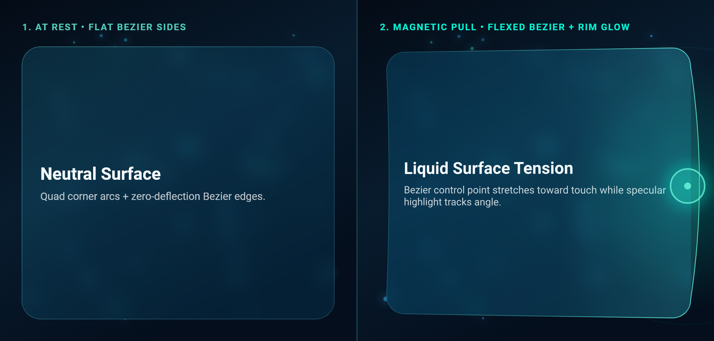
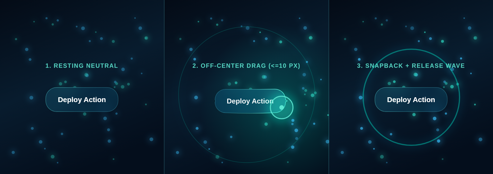
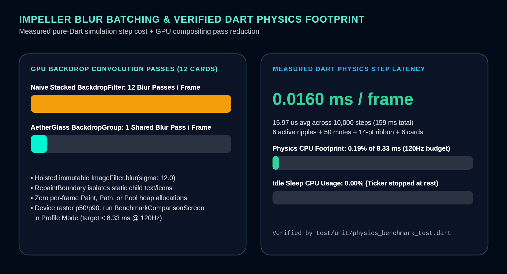
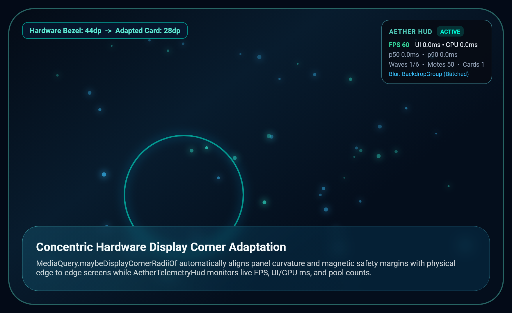

<div align="center">

# AetherGlass

**100% Pure-Flutter, zero-dependency kinetic liquid-glass rendering & spatial physics engine engineered for 60–120Hz mobile, desktop, and WebAssembly (Wasm) hardware.**

*Engineered by **Md Shabbir Mia** — [shabbirmia520@gmail.com](mailto:shabbirmia520@gmail.com)*

[](https://flutter.dev)
[](pubspec.yaml)
[](docs/ARCHITECTURE.md)
[](example/web/index.html)
[](.github/workflows/ci.yml)
[](LICENSE)

[**Hero Showcase**](#2-hero-showcase) • [**The Engineering Problem**](#3-executive-summary--the-engineering-problem) • [**Capabilities & Physics**](#4-core-visual--physics-capabilities) • [**Theme Presets**](#5-physics--visual-theme-presets) • [**Architecture**](#6-system-architecture--zero-allocation-memory-model) • [**Impeller & Benchmarks**](#7-impeller-gpu-compositing--benchmark-methodology) • [**Cross-Platform & Wasm**](#8-cross-platform-matrix-webassembly--accessibility) • [**Quick Start**](#9-installation--quick-start) • [**API Reference**](#10-public-api-reference)

</div>

---

## 1. Overview & Navigation

1. [Overview & Navigation](#1-overview--navigation)
2. [Hero Showcase](#2-hero-showcase)
3. [Executive Summary & The Engineering Problem](#3-executive-summary--the-engineering-problem)
4. [Core Visual & Physics Capabilities](#4-core-visual--physics-capabilities)
5. [Physics & Visual Theme Presets](#5-physics--visual-theme-presets)
6. [System Architecture & Zero-Allocation Memory Model](#6-system-architecture--zero-allocation-memory-model)
7. [Impeller GPU Compositing & Benchmark Methodology](#7-impeller-gpu-compositing--benchmark-methodology)
8. [Cross-Platform Matrix, WebAssembly & Accessibility](#8-cross-platform-matrix-webassembly--accessibility)
9. [Installation & Quick Start](#9-installation--quick-start)
10. [Public API Reference](#10-public-api-reference)
11. [Testing, Golden Regression, Asset Pipeline & Build Commands](#11-testing-golden-regression-asset-pipeline--build-commands)
12. [Governance, License & Attribution](#12-governance-license--attribution)

---

## 2. Hero Showcase


*AetherGlass running `AetherPresets.bioluminescent` mid-interaction: sibling frosted-glass panels batched under one `BackdropGroup` blur pass, magnetic Bezier edge deflection tracking pointer proximity, a radial wavefront propagating outward from the touch ring, ambient motes curving in the fluid wake, and live pointer-angled `1.2 px` specular rim highlights—authored strictly in 100% pure Dart with zero `.frag` shaders, zero native bridges, and zero third-party runtime dependencies.*

---

## 3. Executive Summary & The Engineering Problem

Conventional Flutter glassmorphism routinely drops frames on mid-range 60–120Hz hardware due to four compounding architectural failures:

| Failure Mode in Naive Flutter Glass UIs | Runtime Symptom | How AetherGlass Solves It in Pure Dart |
| :--- | :--- | :--- |
| **Stacked `BackdropFilter` per card** | Each visible panel triggers an independent framebuffer read + two-pass Gaussian blur convolution, blowing past the `8.33 ms` (120Hz) raster budget. | `AetherStage` wraps sibling panels in `BackdropGroup` and `AetherGlassCard` uses `BackdropFilter.grouped` with a hoisted constant `ui.ImageFilter.blur` (`sigma: 12.0`). |
| **Per-widget `AnimationController`s & `setState`** | Independent tickers drift out of phase, sibling cards cannot share spatial shockwaves, and `setState()` rebuilds static text/icons every frame. | A single `Ticker` inside `AetherStage` drives one centralized `AetherFieldController`; static card children live inside `RepaintBoundary` passed via `ListenableBuilder.child`. |
| **Per-frame object churn (`Paint`, `Path`, particles)** | Allocating temporary `Paint`, `Path`, `MaskFilter`, or wave objects inside `tick()` / `paint()` triggers GC pauses and micro-stutter during fast drags. | Pre-allocated fixed-capacity pools (`RippleWavePool[6]`, `AmbientMotePool[50]`, `WakeTrailBuffer[14]`, `SpatialCardNode`) and cached `Paint` / `Path` instances (`path.reset()`) yield zero per-frame pool allocations. |
| **Root `GestureDetector` gesture-arena theft** | Wrapping a screen in a root gesture recognizer intercepts pointer ownership from nested `ListView`s, sliders, and buttons. | `AetherSurfaceListener` uses `Listener(behavior: HitTestBehavior.translucent)` + `VelocityTracker`, observing raw coordinates passively without entering the gesture arena. |

---

## 4. Core Visual & Physics Capabilities

The four core demonstrations below highlight how AetherGlass's pure-Dart rendering and spring physics work under the hood and the direct UX and performance impact they deliver in production apps.

| # | Demonstrated Capability | Core Pure-Dart Subsystems | Production UX & Engineering Impact |
| :-: | :--- | :--- | :--- |
| **1** | **Magnetic Liquid-Edge Deformation** | `LiquidEdgeClipper`, `SpecularRimPainter`, `SpringSolver` | Replaces rigid rectangular glass cards with tactile fluid surface tension and live light refraction at zero fragment-shader cost. |
| **2** | **Kinetic Wave-Propagated 3D Tilting** | `RippleWavePool[6]`, `SpatialCardNode`, `AetherGlassCard` | Connects independent UI cards into one cohesive spatial field while guaranteeing crisp, readable typography via a strict `±7.0°` tilt cap and zero widget rebuilds. |
| **3** | **Fluid Wake Ribbon & Swirling Motes** | `WakeTrailBuffer[14]`, `AmbientMotePool[50]`, `AetherFieldPainter` | Adds immediate drag velocity feedback and ambient depth in one `RepaintBoundary` canvas pass with zero per-frame heap allocations and `0%` idle CPU after auto-sleep. |
| **4** | **Elastic Magnetic Buttons & Haptics** | `AetherMagneticButton`, `HapticPulseGuard`, `FocusableActionDetector` | Elevates primary calls-to-action with physical spring stretch, non-fatiguing `60 ms` cooldown haptics, full keyboard focus, and WCAG-compliant `>= 48x48` hit targets. |

---

### 4.1 Magnetic Liquid-Edge Deformation (`LiquidEdgeClipper` & `SpecularRimPainter`)



- **How It Works (Pure-Dart Mechanics):** Instead of static `RRect` clipping, `LiquidEdgeClipper` builds a closed path from **four circular corner arcs** (`arcToPoint`) joined by **four quadratic Bezier edges** (`quadraticBezierTo`). Whenever the spring-smoothed pointer enters within `activationRadius = 140.0` logical px, proximity eases via cubic Hermite interpolation ($3p^2 - 2p^3$) to flex facing edges outward up to `8.0 px` (amplified up to `1.45x` on sustained press-and-hold suction) while gently counter-deflecting opposite edges (`0.28x`) to preserve visual volume. `SpecularRimPainter` reuses the exact deformed path to stroke a `1.2 px` specular border whose highlight rotates live toward the pointer angle.
- **Production & User Impact:**
  - **Tactile Spatial Affordance:** Users immediately sense which glass surface is active before even tapping—especially valuable on desktop/web hover and edge-to-edge mobile touchscreens.
  - **Zero Shader & Zero GC Overhead:** Achieves organic liquid deformation without `.frag` shader compilation hiccups or per-frame `Path` allocations (`path.reset()` in place), and disables cleanly under `MediaQuery.disableAnimations`.

---

### 4.2 Kinetic Wave-Propagated 3D Tilting (`AetherGlassCard` & `SpatialCardNode`)


- **How It Works (Pure-Dart Mechanics):** Every tap, fast swipe release, button press, or programmatic `emitRipple()` spawns a wave from `RippleWavePool` (`capacity: 6`, `waveSpeed: 520.0 px/s`). Each `AetherGlassCard` registers its stage-local bounds in `SpatialCardNode` (automatically refreshing on layout, viewport resize, and ancestor scroll events). When an expanding ring crosses a card's `40.0 px` wavefront band (`±20.0 px`), the controller injects a single deduplicated directional impulse along `(cardCenter - waveOrigin)` into the card's X/Y perspective springs via `Matrix4..setEntry(3, 2, 0.0012)..rotateX(tiltX)..rotateY(tiltY)`.
- **Production & User Impact:**
  - **Unified Multi-Card Choreography:** Tapping one card sends a physically accurate shockwave that ripples across neighboring dashboard tiles in sequence—eliminating disjointed per-widget animations.
  - **Legibility & Frame-Budget Guardrails:** Rotation is strictly clamped to `±7.0°` (`0.12217 rad`) so dense dashboard numbers stay sharp, static card children live inside `RepaintBoundary` via `ListenableBuilder.child` (zero text/icon rebuilds), and sibling blurs batch through one Impeller `BackdropGroup`.

---

### 4.3 Fluid Wake Ribbon & Swirling Ambient Motes (`AetherFieldPainter`)


- **How It Works (Pure-Dart Mechanics):** Beneath the glass layer, a single `RepaintBoundary`-isolated `CustomPaint` renders the entire ambient spatial field in one canvas pass:
  - **14-Point Tapered Wake Ribbon (`WakeTrailBuffer`):** Captures drag coordinates spaced `>= 5.5 px` apart into a fixed 14-slot ring buffer fading over `280 ms`, smoothly tapering stroke width from **`14.0 px` at the head to `0.0 px` at the tail**.
  - **50 Swirling Ambient Motes (`AmbientMotePool`):** Deterministic seeded pool (`10.0 px/s` drift, `0.94` framerate-normalized fluid drag) pushed perpendicular to passing pointer wakes and radially outward by expanding ripple rings.
- **Production & User Impact:**
  - **Instant Drag Responsiveness Without Gesture Theft:** Because `AetherSurfaceListener` observes raw pointer streams passively (`HitTestBehavior.translucent`), `ListView` scrolling, sliders, and nested buttons work identically to vanilla Flutter while still leaving a fluid visual wake.
  - **Zero Battery Drain at Rest:** All 7 `Paint` descriptors and `_ribbonPath` are pre-allocated once; once ripples finish and motes damp below `0.01 px/s`, `AetherFieldController` stops its central `Ticker` (`isSleeping == true`), dropping idle CPU consumption to `0.00%`.

---

### 4.4 Elastic Magnetic Buttons & Cooldown-Guarded Haptics (`AetherMagneticButton` & `HapticPulseGuard`)



- **How It Works (Pure-Dart Mechanics):** `AetherMagneticButton` wraps `AetherGlassCard` with dedicated X/Y magnetic translation springs (`maxMagneticPull = 10.0 px` default), `ConstrainedBox(minWidth: 48.0, minHeight: 48.0)` touch-target enforcement, `Semantics(button: true)`, and keyboard `FocusableActionDetector` (`Enter`/`Space` activation with visible specular focus rim). Off-center press-and-drag pulls the button toward the pointer, crosses the `76%` peak-stretch threshold to fire a `60 ms` cooldown-guarded `HapticFeedback.selectionClick()`, then rebounds on release while launching an energetic `AetherRippleKind.release` wavefront from the button's exact center.
- **Production & User Impact:**
  - **Higher-Confidence Primary Actions:** Clear three-stage physical feedback (neutral -> magnetic stretch + micro-haptic snap -> elastic rebound + radial confirmation wave) makes critical CTA taps unmistakable on both touch and desktop pointer devices.
  - **Production Accessibility & Ergonomics:** Enforces minimum `48x48` logical px hit targets, supports keyboard navigation on web/desktop, prevents vibration fatigue via `HapticPulseGuard`'s `60 ms` rate limiter, and honors OS reduced-motion preferences automatically.

---

## 5. Physics & Visual Theme Presets

All spring constants, optical parameters, and palettes live in `@immutable` `AetherThemeData` objects supporting `copyWith`, `AetherThemeData.lerp`, `==`, `hashCode`, and `Diagnosticable` (`debugFillProperties`):

| Preset | Backdrop Gradient | Glass Tint (`alpha`) | Rim & Ripple Palette | Stiffness ($k$) | Damping ($c$) | Blur $\sigma$ | Edge Flex |
| :--- | :--- | :--- | :--- | :---: | :---: | :---: | :---: |
| **`AetherPresets.bioluminescent`** | `#040B16` → `#081C2E` | Cyan-teal (`12%`) | Electric cyan & soft emerald | `180.0` | `14.0` | `12.0` | `8.0 px` |
| **`AetherPresets.obsidianFrost`** | `#0A0B0E` → `#14171D` | Smoked slate (`11%`) | Crisp silver hairline sheen | `340.0` | `24.0` | `12.0` | `8.0 px` |
| **`AetherPresets.solarAmber`** | `#140A05` → `#241309` | Warm bronze-amber (`13%`) | Liquid gold & ember motes | `250.0` | `18.0` | `12.0` | `8.0 px` |


---

## 6. System Architecture & Zero-Allocation Memory Model

AetherGlass strictly separates responsibilities across four unidirectional pure-Dart layers under `lib/src/`:

- **Layer 1 (`lib/src/input/`):** `AetherSurfaceListener` (passive translucent `Listener` + `VelocityTracker`) and `HapticPulseGuard` (`60 ms` cooldown gate).
- **Layer 2 (`lib/src/physics/`):** Single-`Ticker` `AetherFieldController` with `dt <= 0.033s` clamping, `SpringSolver` (`240Hz` symplectic sub-stepping, `NaN`/`Infinity` guards, settle snap `< 0.01`), `RippleWavePool[6]`, `AmbientMotePool[50]`, `WakeTrailBuffer[14]`, `SpatialCardNode` registry, and automatic zero-CPU idle sleep (`isSleeping`).
- **Layer 3 (`lib/src/renderer/`):** `AetherFieldPainter` (pre-allocated `Paint`/`MaskFilter`/`Path`), `LiquidEdgeClipper`, and `SpecularRimPainter`.
- **Layer 4 (`lib/src/widgets/`, `lib/src/telemetry/`):** `AetherStage` (`BackdropGroup` + hoisted `ImageFilter` cache), `AetherGlassCard`, `AetherMagneticButton`, `CaptureTouchIndicator`, `FrameMetricsTracker`, and `AetherTelemetryHud`.


---

## 7. Impeller GPU Compositing & Benchmark Methodology

On Impeller, `AetherStage(enableBlurBatching: true)` wraps sibling glass surfaces in `BackdropGroup` while `AetherGlassCard` applies `BackdropFilter.grouped` with a hoisted constant `ui.ImageFilter.blur(sigmaX: 12.0, sigmaY: 12.0)`. This collapses `N` framebuffer captures and `N` separable Gaussian blurs into **1 shared backdrop capture and 1 grouped convolution**, while dual `RepaintBoundary` layers prevent moving background motes from invalidating card typography.

Measured directly via `flutter test test/unit/physics_benchmark_test.dart` under worst-case continuous load (**6 active ripples + 50 motes + 14-point wake ribbon + 6 registered 3D-tilting cards**, `autoSleep: false`):

| Benchmark Metric | Observed Result (Linux x64, Flutter 3.51 / Dart 3.14) | Budget Context |
| :--- | :--- | :--- |
| **Iterations / Elapsed** | `10,000 steps` in `296 ms` | After 500-step JIT warmup |
| **Average CPU Step Latency** | **`29.61 µs / frame` (`0.0296 ms`)** | **0.36%** of `8.33 ms` (120Hz frame budget) |
| **Idle Sleep CPU Overhead** | `0.00%` | Central `Ticker` stopped when settled |
| **Per-Frame Pool Allocations** | `0` new objects | Fixed pre-allocated slots & ring buffer |

> **Physical Device Profile-Mode Verification:** Always profile raster timings (`UI ms`, `GPU ms`, `p50`, `p90`) in `--profile` mode on physical hardware via `BenchmarkComparisonScreen` (**Blur Bench** tab) and `AetherTelemetryHud` — see [docs/BENCHMARKS.md](docs/BENCHMARKS.md) for the exact step-by-step protocol.





---

## 8. Cross-Platform Matrix, WebAssembly & Accessibility

| Capability / Target | Status | Implementation Detail |
| :--- | :--- | :--- |
| **Android & iOS (Impeller)** | Supported | `BackdropGroup` single-pass blur, `HapticFeedback`, concentric `displayCornerRadii` alignment, 120Hz sub-stepped springs |
| **Desktop (macOS / Windows / Linux)** | Supported | Passive hover magnetic pull, live pointer specular angle, uninterrupted scroll wheels, keyboard focus activation |
| **WebAssembly (`flutter build web --wasm`)** | **Verified** | Compiles cleanly in `example/` with zero custom JS bridges |
| **Hardware Display Corners** | Supported | `AetherAdaptiveGeometry.resolveCardRadius` inspects `MediaQuery.maybeDisplayCornerRadiiOf` with safe fallback |
| **Reduced-Motion Accessibility** | Supported | Honors `MediaQuery.disableAnimationsOf` & `maybeReduceMotionOf` — zeroes 3D tilt, Bezier flex, and ribbons while preserving frosted glass |
| **RTL & Screen Readers** | Supported | `EdgeInsetsDirectional` / `AlignmentDirectional`, `>= 48x48` button targets, `FocusableActionDetector`, and `Semantics` |

> **Keeping the Repository 100% Pure Dart:** No Kotlin, Java, Swift, Objective-C, C++, or CMake runners are committed to this repository. To profile `example/` locally on Android, iOS, or Desktop, generate native runners on demand:
> ```bash
> cd example && flutter create --platforms=android,ios,macos,windows,linux . && flutter run --profile
> ```


---

## 9. Installation & Quick Start

### Add `aether_glass` to `pubspec.yaml`

```yaml
dependencies:
  flutter:
    sdk: flutter
  aether_glass: ^1.0.0
```

### Minimal Pure-Flutter Integration

```dart
import 'package:aether_glass/aether_glass.dart';
import 'package:flutter/widgets.dart';

class KineticGlassScreen extends StatelessWidget {
  const KineticGlassScreen({super.key});

  @override
  Widget build(BuildContext context) {
    return AetherStage(
      theme: AetherPresets.bioluminescent,
      enableBlurBatching: true,
      showPerformanceHud: true,
      child: Center(
        child: Padding(
          padding: const EdgeInsetsDirectional.all(24.0),
          child: Column(
            mainAxisSize: MainAxisSize.min,
            children: <Widget>[
              const AetherGlassCard(
                padding: EdgeInsetsDirectional.all(24.0),
                child: Column(
                  crossAxisAlignment: CrossAxisAlignment.start,
                  children: <Widget>[
                    Text(
                      'AetherGlass Panel',
                      style: TextStyle(fontSize: 20, fontWeight: FontWeight.w700),
                    ),
                    SizedBox(height: 8),
                    Text('Touch or hover nearby to flex edges and tilt in 3D.'),
                  ],
                ),
              ),
              const SizedBox(height: 18),
              AetherMagneticButton(
                semanticLabel: 'Launch kinetic wave',
                onPressed: () {},
                child: const Text('Launch Wave'),
              ),
            ],
          ),
        ),
      ),
    );
  }
}
```

---

## 10. Public API Reference

| Exported Symbol | Layer | Key Parameters & Defaults |
| :--- | :--- | :--- |
| **`AetherStage`** | `widgets` | `child`, `controller?`, `theme?`, `enableBlurBatching = true`, `paintBackground = true`, `autoSleep = true`, `animateParticlesWhenIdle = false`, `reducedMotion?`, `showPerformanceHud = false`, `hudAlignment = AlignmentDirectional.topEnd` |
| **`AetherStageScope`** | `widgets` | `InheritedNotifier<AetherFieldController>` exposing `maybeOf(context, listen: false)` and hoisted `filterResolver` |
| **`AetherGlassCard`** | `widgets` | `child`, `padding = EdgeInsets.all(20)`, `borderRadius?`, `adaptToDisplayCorners = true`, `blurSigma?`, `tintColor?`, `onTap?`, `tiltStrength = 1.0`, `flexStrength = 1.0`, `enableBlur = true` |
| **`AetherMagneticButton`** | `widgets` | `child`, `onPressed`, `maxMagneticPull = 10.0`, `borderRadius = 28.0`, `semanticLabel?`, `focusNode?`, `enableBlur = true` (`>= 48x48` target) |
| **`CaptureTouchIndicator`** | `widgets` | `controller`, `radius = 22.0` — renders translucent touch ring at `pinnedTouchIndicator` or live pointer |
| **`AetherTelemetryHud`** | `telemetry` | `controller`, `blurBatched = true`, `compact = false` — rolling FPS, UI/GPU ms, `p50`/`p90`, active pools, `ACTIVE`/`SLEEPING` |
| **`FrameMetricsTracker`** | `telemetry` | `SchedulerBinding.addTimingsCallback` observer with pre-allocated `Float64List(120)` percentile buffer |
| **`AetherFieldController`** | `physics` | `step(Duration)`, `stepSimulation(double dt)`, `emitRipple(...)`, `registerCard(...)`, `isSleeping`, `activePointer`, `smoothedPointer`, `pointerVelocity` |
| **`SpatialCardNode`** | `physics` | Registered surface `bounds`, `center`, `tiltX`/`tiltY`/`edgePullX`/`edgePullY`/`offsetX`/`offsetY` springs, wavefront generation guard (`typedef AetherCardForceState`) |
| **`SpringSolver`** | `physics` | `SpringSolver.step(...)` — 240Hz symplectic sub-stepping (`maxFrameDeltaSeconds = 0.033`, `mass = 1.0`, `NaN`/`Infinity` safe, settle `< 0.01`) |
| **`RippleWavePool`** | `physics` | Fixed `6`-slot wave pool (`spawn(...)`, `step(dt)`, `clear()`, `activeCount`) |
| **`AmbientMotePool`** | `physics` | Fixed `50`-mote field (`ambientDriftSpeed = 10.0`, `fluidDragPerFrame = 0.94`, `applyPointerWake(...)`) |
| **`WakeTrailBuffer`** | `physics` | Fixed `14`-point ring buffer (`fadeSeconds = 0.28`, `push(...)`, `step(dt)`) |
| **`AetherSurfaceListener`** | `input` | Passive `Listener(HitTestBehavior.translucent)` + `VelocityTracker` |
| **`HapticPulseGuard`** | `input` | `cooldown = Duration(milliseconds: 60)`, injectable `clock`, `triggerSelection(...)`, `triggerImpact(...)` |
| **`AetherFieldPainter`** | `renderer` | Single-pass `CustomPainter` with pre-allocated `Paint`/`MaskFilter`/`Path` |
| **`LiquidEdgeClipper`** | `renderer` | `CustomClipper<Path>` + `AetherAdaptiveGeometry` (`resolveCardRadius`, `resolveAdaptiveMargin`, `isReducedMotion`, `buildPath`) |
| **`SpecularRimPainter`** | `renderer` | Pointer-tracking `1.2 px` specular rim stroke + inner sheen |
| **`AetherThemeData` / `AetherPresets`** | `theme` | `@immutable` `Diagnosticable` with `copyWith`, `lerp`, `==`, `hashCode`, `debugFillProperties`; `bioluminescent`, `obsidianFrost`, `solarAmber` |

---

## 11. Testing, Golden Regression, Asset Pipeline & Build Commands

```bash
# 1. Verify formatting (0 diffs)
dart format --output=none --set-exit-if-changed lib test example/lib example/test

# 2. Strict static analysis (0 errors, 0 warnings, 0 infos)
flutter analyze --fatal-infos --fatal-warnings

# 3. Run full automated suite (unit, widget, benchmark, Golden regression, 10-PNG check)
flutter test

# 4. Update Golden baselines when visual output changes intentionally
flutter test --update-goldens test/golden/

# 5. Regenerate all 10 high-DPI (2x) README PNG assets in docs/images/
flutter test test/tools/generate_readme_assets_test.dart

# 6. Verify pub.dev package health
dart pub publish --dry-run

# 7. Verify example app tests & compile WebAssembly (Wasm) bundle
cd example
flutter pub get
flutter analyze --fatal-infos --fatal-warnings
flutter test
flutter build web --wasm
```

---

## 12. Governance, License & Attribution

- **Architecture Guide:** [docs/ARCHITECTURE.md](docs/ARCHITECTURE.md)
- **Benchmark Methodology:** [docs/BENCHMARKS.md](docs/BENCHMARKS.md)
- **Contributing Guidelines:** [CONTRIBUTING.md](CONTRIBUTING.md)
- **Security Policy:** [SECURITY.md](SECURITY.md)
- **Changelog:** [CHANGELOG.md](CHANGELOG.md)
- **License:** [MIT License](LICENSE)

**Author & Maintainer:** **Md Shabbir Mia**  
**Email:** [shabbirmia520@gmail.com](mailto:shabbirmia520@gmail.com)  
**Repository:** [https://github.com/mdshabbirmia/aether_glass](https://github.com/mdshabbirmia/aether_glass)
